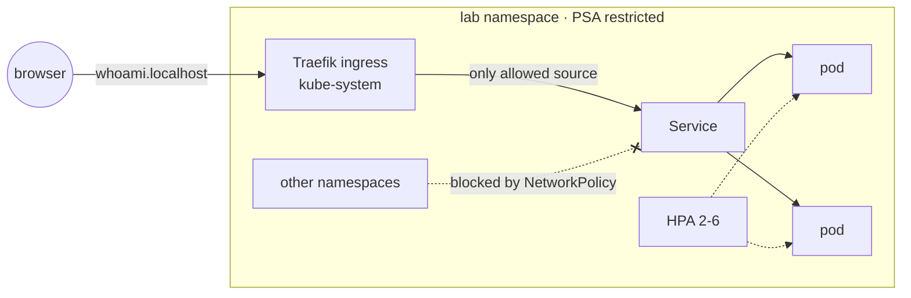
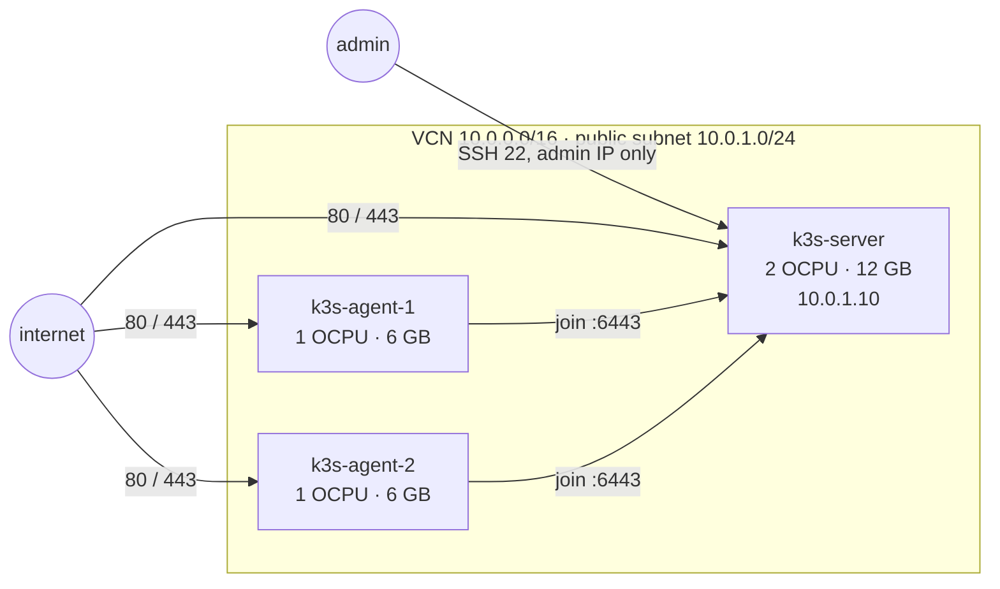

# k3s-homelab

A 3-node Kubernetes lab with [k3s](https://k3s.io) and an app deployed the way it should be in production:
non-root, network-isolated, autoscaled, and updated without dropping a single request.
CI builds a real cluster on every push and **proves** those properties with an end-to-end test.



## Three ways to run the cluster

| | Command | What you get |
|---|---|---|
| **VMs** | `make vm-up` | 1 server + 2 agents as Ubuntu VMs in [Multipass](https://multipass.run) (macOS, Windows, Linux) |
| **Docker** | `make up` | same shape in containers with [k3d](https://k3d.io), starts in ~30 s, used by CI |
| **Oracle Cloud** | `make oci-up` | same shape on Ampere VMs in OCI's Always Free tier, built with [Terraform](infra/oci) |

```bash
make up          # cluster
make deploy      # kubectl apply -k apps/whoami/overlays/lab
make test        # smoke test below
curl -H "Host: whoami.localhost" http://localhost:8080
```

## Oracle Cloud with Terraform

`infra/oci` builds the cluster on real cloud VMs and stays inside OCI Always Free
(4 Ampere OCPUs, 24 GB memory, 200 GB storage in total).



```bash
cp infra/oci/terraform.tfvars.example infra/oci/terraform.tfvars   # tenancy, SSH key, your IP
make oci-up          # VCN, subnet, security list, 3 VMs; cloud-init installs k3s
make oci-kubeconfig  # waits for k3s, writes ./kubeconfig-oci
make oci-tunnel      # second terminal: API only through SSH
KUBECONFIG=$PWD/kubeconfig-oci make deploy test
make oci-down
```

| Decision | Why |
|---|---|
| Kubernetes API not exposed | port 6443 is open only inside the VCN; `kubectl` goes through an SSH tunnel |
| SSH only from `admin_cidr` | validated: `0.0.0.0/0` is rejected before anything is created |
| Fixed private IP for the server, shared join token from Terraform | agents join on first boot, no SSH round trip to read the node token |
| Always Free guard | a `precondition` stops `apply` if node count or sizes would leave the free tier |
| iptables rules in cloud-init | Ubuntu images on OCI reject everything except SSH by default, so VXLAN and ingress would silently fail |
| `ignore_changes` on the image | a newer Ubuntu build does not recreate running nodes |

CI runs `terraform fmt`, `terraform validate` and `tflint` on every push. It has no cloud credentials, so it
does not apply anything; the end-to-end proof stays on the k3d cluster. Ampere capacity in OCI is often
exhausted in popular regions: if `apply` reports *Out of host capacity*, try another
`availability_domain_index` or later.

## What the deployment does

| Concern | How |
|---|---|
| Security | non-root UID, read-only root filesystem, all capabilities dropped, seccomp, no service-account token, namespace enforces Pod Security *restricted* |
| Network | default-deny NetworkPolicy, only Traefik may reach the pods |
| Availability | ≥ 2 replicas spread across nodes, PodDisruptionBudget, `maxUnavailable: 0` rolling updates, readiness probe + `preStop` delay |
| Scaling | HorizontalPodAutoscaler on CPU (k3s ships metrics-server) |
| Environments | Kustomize base + overlays: `lab` and `prod-like` (3 replicas, strict spreading, own host and config) |

## The smoke test

`scripts/smoke-test.sh` runs against any cluster and checks behaviour, not just YAML:

1. the app answers through the ingress,
2. a pod in another namespace **cannot** reach it directly (NetworkPolicy works),
3. a rolling restart under constant load produces **0 failed requests**,
4. deleting a pod under load produces **0 failed requests**.

CI runs `make validate` (kustomize build + kubeconform strict schema check + shellcheck) and then the
full smoke test on a fresh k3d cluster.

## Design decisions

- **Kustomize over Helm** for a single in-house app: plain YAML that `kubectl` understands, environment differences as small, reviewable patches.
- **Explicit selectors.** Kustomize's `includeSelectors` would also rewrite the Traefik selector inside the NetworkPolicy and silently block all traffic, so selectors are written out and only pod templates get the common labels.
- **Test the promises.** "Zero-downtime" and "isolated" are claims; the smoke test turns them into checks that fail the build.

## Possible next steps

Remote state for the Terraform code (OCI Object Storage), GitOps with Argo CD or Flux, and the [observatory](https://github.com/antony-bdc/observatory) stack on the cluster via kube-prometheus-stack.
